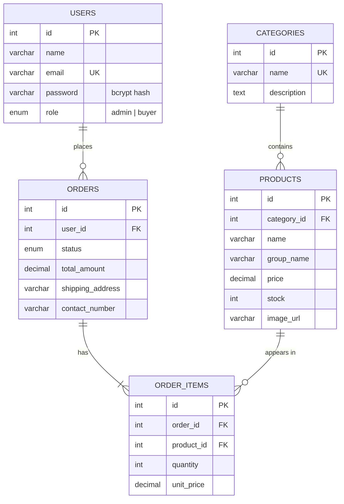

# K-cartz Backend

A RESTful backend for **K-cartz**, an online shop for K-pop merchandise (albums, lightsticks, photocards and more). The shop owner (admin) manages the catalog and orders. Customers register as buyers, browse products and place orders.

Final project for **ITEC 116 – IT Elective 4 (Systems Integration and Architecture 2)**, Cavite State University – Imus Campus.

**Author:** Jamaica Icaro (BSIT 4D)

---

## Features

- **Authentication:** register, login with **JWT**, passwords hashed with **bcrypt**, change password
- **Role-based authorization:** `admin` (shop owner) and `buyer` (customers)
- **Categories:** CRUD, with deletion blocked while a category still has products
- **Products:** CRUD, search by name or group, filter by category, and stock updates
- **Orders:** place orders with multiple items inside a **database transaction** (stock is checked and reduced; the total is computed on the server), a status workflow, buyer cancellation that returns stock, and buyers seeing only their own orders
- **Input validation** on every request body and query string
- **27 REST endpoints** using GET, POST, PATCH and DELETE with proper HTTP status codes

## Tech Stack

| Component | Technology |
|---|---|
| Backend framework | NestJS 12 (TypeScript) |
| ORM | TypeORM |
| Database | MySQL (XAMPP / MariaDB) |
| Authentication | JWT (`@nestjs/jwt`) + bcrypt |
| Validation | class-validator, class-transformer |
| API testing | Postman |
| Version control | Git and GitHub |

## Architecture

Each module follows the same layered flow:

```
Client (Postman) -> Controller -> Service -> Repository (TypeORM) -> MySQL
```

- **Controller** receives the HTTP request, applies guards and validation, and calls the service.
- **Service** holds the business logic (stock checks, totals, status rules).
- **Repository / Entity** maps TypeScript classes to MySQL tables through TypeORM.

```
src/
├── auth/          # register, login, JWT guard, roles guard, change password
├── users/         # user entity, admin user management
├── categories/    # product categories
├── products/      # product catalog and stock
├── orders/        # orders and order items
├── app.module.ts  # database connection and module imports
└── main.ts        # app bootstrap and global validation
```

## Database Design



## API Endpoints

Base URL: `http://localhost:3000`

| Method | Endpoint | Access | Description |
|---|---|---|---|
| POST | `/auth/register` | Public | Register a buyer account |
| POST | `/auth/login` | Public | Log in and receive a JWT |
| GET | `/auth/profile` | Logged in | Current user's profile |
| PATCH | `/auth/change-password` | Logged in | Change own password |
| GET | `/users` | Admin | List users |
| GET | `/users/:id` | Admin | Get a user |
| PATCH | `/users/:id` | Admin | Update a user |
| DELETE | `/users/:id` | Admin | Delete a user (blocked if they have orders) |
| GET | `/categories` | Public | List categories |
| GET | `/categories/:id` | Public | Get a category with its products |
| POST | `/categories` | Admin | Create a category |
| PATCH | `/categories/:id` | Admin | Update a category |
| DELETE | `/categories/:id` | Admin | Delete a category (blocked if it has products) |
| GET | `/products` | Public | List products (`?categoryId=` and `?search=`) |
| GET | `/products/:id` | Public | Get a product |
| POST | `/products` | Admin | Create a product |
| PATCH | `/products/:id` | Admin | Update a product |
| PATCH | `/products/:id/stock` | Admin | Set the stock quantity |
| DELETE | `/products/:id` | Admin | Delete a product (blocked if it was ordered) |
| POST | `/orders` | Logged in | Place an order |
| GET | `/orders/my` | Logged in | Own orders |
| GET | `/orders/:id` | Owner / Admin | Get an order |
| PATCH | `/orders/:id/cancel` | Owner | Cancel a pending order (stock is returned) |
| GET | `/orders` | Admin | List all orders (`?status=`) |
| PATCH | `/orders/:id/status` | Admin | Update the order status |
| DELETE | `/orders/:id` | Admin | Delete a cancelled or completed order |
| GET | `/` | Public | Health check |

Protected routes need the header `Authorization: Bearer <token>`. The full Postman collection is included with the submission.

### Status codes used

`200 OK`, `201 Created`, `400 Bad Request` (validation), `401 Unauthorized` (missing or invalid token), `403 Forbidden` (wrong role or not the owner), `404 Not Found`, `409 Conflict` (duplicates, not enough stock, protected deletes).

## How to Run Locally

### Requirements

- Node.js 22 or newer
- XAMPP (MySQL and phpMyAdmin)
- Git

### Steps

1. **Clone the repository**
   ```bash
   git clone https://github.com/JamaicaI/kcartz-backend.git
   cd kcartz-backend
   ```

2. **Install dependencies**
   ```bash
   npm install
   ```

3. **Create the database.** Start MySQL in XAMPP, open phpMyAdmin and create a database named `kcartz_db`. The tables are created automatically on the first run.

4. **Configure environment variables.** Copy `.env.example` to `.env` and fill in the values:
   ```bash
   copy .env.example .env
   ```
   | Variable | Description |
   |---|---|
   | `DB_HOST`, `DB_PORT`, `DB_USERNAME`, `DB_PASSWORD`, `DB_NAME` | MySQL connection |
   | `JWT_SECRET` | Long random string used to sign tokens |
   | `JWT_EXPIRES_IN` | Token lifetime, e.g. `1d` |
   | `ADMIN_NAME`, `ADMIN_EMAIL`, `ADMIN_PASSWORD` | Admin account created on the first run |

5. **Start the server**
   ```bash
   npm run start:dev
   ```
   The API runs at `http://localhost:3000`. On the first start, the log shows `Admin account created for ...`.

6. **Test with Postman.** Import the Postman collection and run **Auth > Login (Admin)** first. The token is saved automatically for the other requests.

## Security Notes

- Passwords are never stored in plain text (bcrypt, 10 salt rounds) and are never returned by the API.
- Secrets live in `.env`, which is excluded from Git by `.gitignore`.
- Order prices and totals are calculated on the server from database values.
- Request bodies are whitelisted: unknown fields are rejected with `400`.
- `synchronize: true` is used for development only. A production deployment should use TypeORM migrations instead.
